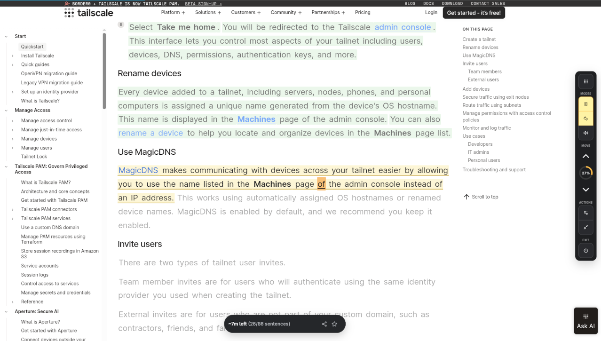

# Just Read It — Focus Reader & Read Aloud

Just Read It makes long articles easier to read. It keeps you focused sentence by sentence, offers a distraction-free Rapid Serial Visual Presentation (RSVP) view, remembers your progress, and can read the remaining content aloud.

## Install

- [Install from the Chrome Web Store](https://chromewebstore.google.com/detail/web-reader/kbbhnbiomlnlfgbgehgbbdjghhiamhme)
- [Install from Firefox Add-ons](https://addons.mozilla.org/en-US/firefox/addon/just-read-it/)

[](images/screenshot-1.png)

## Features

- Highlights one sentence at a time to keep your focus.
- Tracks read and unread sentences for each page.
- Restores your reading progress when you return to a page.
- Supports Guided Reading with word-level focus and automatic advancement.
- Includes a Rapid Serial Visual Presentation (RSVP) view for distraction-free, word-by-word reading.
- Reads the current sentence and remaining unread sentences aloud.
- Works with pages that update their content without a full reload.
- Includes touch-friendly controls for mobile browsers.
- Lets you continue an article on another device with a progress link or QR code.

## How To Use

1. Open a long-form article or other page you want to read.
2. Open the Just Read It toolbar popup, right-click the page, or press `Alt+Shift+L` (`Command+Shift+L` on macOS).
3. Select **Enable Reading Mode**.
4. Use the controls on the page to navigate through the content.

The extension is disabled by default and must be enabled separately for each page. You can also enable or disable it from the page's right-click menu.

## Controls

- **Previous** and **Next** move between sentences.
- **Guide** starts or stops Guided Reading.
- **Read Aloud** reads the current sentence and continues through the remaining unread content.
- **Reset** clears the saved reading progress for the page.
- **Exit** disables reading mode for the page.

Keyboard shortcuts are available on desktop. On touch devices, use the control dock at the bottom of the page.

## Reading History

Reading history is optional. Choose **Keep Reading History** in the popup to resume articles, see reading and listening time, and save favorites. Reading progress stays in local extension storage. Browser-syncable settings and per-site preferences may use your browser's sync storage when it is enabled.

## Continue On Another Device

Use the share button in the reader controls to copy a continuation link or scan its QR code. The link includes the article URL and your reading position in its fragment, so share it only with people or devices you trust. Just Read It must be installed on the receiving browser to restore the saved position.

## Browser Support

Firefox 128 or later is the primary supported browser. Chrome is also supported. Read Aloud requires a browser-provided compatible voice, so availability may vary by browser and device.

## Development

The extension is built with [WXT](https://wxt.dev/), TypeScript, HTML, and CSS. Both production targets use Manifest V3. Tests run with Vitest and a Happy DOM environment; ESLint and Prettier handle linting and formatting.

### Local Setup

Use a current Node.js LTS release and npm. From the repository root, install the locked dependencies:

```sh
npm ci
```

The install hook runs `wxt prepare` to generate WXT's configuration and types.

Start a development session for your browser:

```sh
npm run dev:firefox
# Or:
npm run dev:chrome
```

### Build and Load Locally

```sh
npm run build
```

This builds both browser targets. To build only one, use `npm run build:firefox` or `npm run build:chrome`.

| Browser | Output | Load the production build locally |
| --- | --- | --- |
| Chrome | `.output/chrome-mv3/` | Open `chrome://extensions`, enable **Developer mode**, choose **Load unpacked**, and select the output directory. |
| Firefox | `.output/firefox-mv3/` | Open `about:debugging#/runtime/this-firefox`, choose **Load Temporary Add-on**, and select `manifest.json` in the output directory. |

Firefox's temporary installation lasts until the browser restarts.

To generate distribution archives in `.output/`:

```sh
npm run zip
```

Browser-specific packaging is also available through `npm run zip:firefox` and `npm run zip:chrome`.

### Checks

```sh
npm run typecheck
npm run lint
npm test
```

Use `npm run test:watch` during development. Run an individual test file with, for example, `npm test -- tests/web/reader/controls.test.ts`. `npm run format` applies Prettier formatting across the repository.

### Project Layout

```text
entrypoints/       Browser extension entrypoints and HTML pages
lib/               Shared TypeScript modules
assets/            Reader styles
styles/            Shared UI styles
public/            Static assets copied into the extension
tests/             Vitest test suites
wxt.config.ts      Manifest, browser settings, and build hooks
vitest.config.ts   Test environment and discovery configuration
```

### Permissions and Storage

The manifest requests `activeTab`, `storage`, `scripting`, `contextMenus`, and `clipboardWrite`. HTTP and HTTPS site access is declared as optional host permissions. The Chrome build also adds `tts` for browser-provided speech synthesis.

Reading progress and history stay in local extension storage. Settings and per-site preferences may use browser sync storage. Cross-device continuation uses a link containing the article URL and reading position; the receiving browser needs the extension installed.

See the [privacy policy](PRIVACY.md) for details about data handling and site access.

## License

Licensed under [Apache-2.0](LICENSE). See [third-party notices](THIRD_PARTY_NOTICES.md) for bundled components and their licenses.
